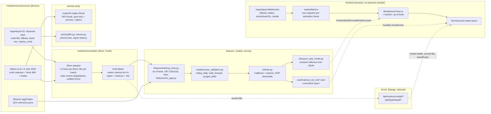

# MarketImmune architecture

MarketImmune predicts which Hyperliquid perp fills a market maker will regret
10 seconds later. There are three paths: an **offline research path** that turns
Hyperliquid archives into a validated CatBoost model, a **live path** that labels
(and, with an exported model, scores) every SOL-PERP fill as it prints, and the
**priority study** (formerly *The Price of Priority*) that replays the book under
HyperCore's cancel-first batch order to price speed and priority fees.



## Data layout

Everything under `data/` is gitignored. `marketimmune.config.paths()` resolves it
(override with `MARKETIMMUNE_DATA`), and `marketimmune.lake.tables.HyperliquidLakeLayout`
names every Silver and Gold file.

```text
data/
├── bronze/
│   ├── albers/                 Zenodo archives as downloaded (tar / tar.xz) + MANIFEST.json
│   ├── binance/aggTrades/      daily zips, sha256-verified
│   └── hyperliquid/            raw node fills from S3
├── silver/hyperliquid/         l2_book/, fills/, order_events/, asset_ctxs/, candles/ per coin and day
├── gold/hyperliquid/           markout labels and training rows (+ .leakage.json sidecars)
├── models/                     trained .cbm, isotonic calibrators, web-model JSON
└── logs/
```

## Label

For a maker fill at time `t`, price `p`, maker side `s` (+1 the maker bought,
-1 it sold):

```
markout_bps = s * (mid_{t+10s} - p) / p * 10_000      # first mid at or after t+10s
regretted   = markout_bps < -1.0                        # 1 bps fee hurdle
```

This is the rule behind the committed SOL report. New runs default to
`MarkoutConfig.reference = "pre_fill_mid"`, which measures from the last mid before
the fill instead of the fill price. `marketimmune/labels/markout.py` is the definition; `marketimmune/lake/gold.py`
applies it to a day of fills with one `searchsorted` per horizon, and
`frontend/src/lib/regret.ts` applies the same rule to live fills.

## Validation

`marketimmune/models/cross_validation.py` implements three schemes on index arrays:

- `rolling_daily` (default): each fold tests one day and trains on the `--train-days`
  days before it, minus the purge.
- `walk_forward`: `n_splits + 1` time blocks, fold `k` tests
  block `k + 1` and trains only on rows before `test_start - purge`.
- `purged_kfold`: `n_splits` blocks, train on everything outside
  `[test_start - purge, test_end + embargo]`. The committed SOL report was produced
  this way; four of its five folds train on later days. Its headline number is the
  forward holdout (train May 27 to 31, score June 1), which is out of time.

The skip threshold is selected per fold from that fold's training-side out-of-fold
predictions, and the deployment threshold from all training out-of-fold rows; the
holdout day never influences either.

## Components

| Path | Role |
|---|---|
| `marketimmune/sources/` | Readers for every external source; no lake writes |
| `marketimmune/lake/tables.py` | Silver/Gold file layout, record builders, parquet writers |
| `marketimmune/lake/gold.py` | Markout labels for a day of fills, one `searchsorted` per horizon |
| `marketimmune/lake/backfill.py` | One requester-pays day from S3 to Gold |
| `marketimmune/labels/` | The regret label and the point-in-time (no look-ahead) checks |
| `marketimmune/features/` | Vectorized OFI windows, as-of feature join, CEX gap |
| `marketimmune/models/` | Temporal splits, evaluation, calibration, promotion policy |
| `marketimmune/serving/` | CatBoost scorer, CatBoost-free oblivious-tree evaluator, Gold scoring |
| `marketimmune/priority/` | Priority-fee fills and nonce-based arrival times |
| `marketimmune/cli/` | Commands; each is `python -m marketimmune.cli.<name>` |
| `crates/hl-replay` | Rust book: slab FIFO levels, cancel-first batch engine, LZ4 line reader |
| `crates/hl-replay-py` | PyO3 module `hl_replay` |
| `server/api` | Django models, views, services; serves the built terminal |
| `frontend/` | React + TypeScript + Vite terminal |
| `eval/` | Benchmark harnesses and committed results |
| `deploy/` | Always-on recorder and cloud notes |

The Python package has no Django dependency; `server/` owns persistence and HTTP.

## Guardrails

MarketImmune sends no orders, holds no keys, and does not identify private
actors. Any new benchmark number must link to a committed artifact in `eval/`.
