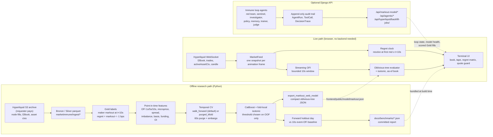

# MarketImmune architecture

MarketImmune predicts which SOL perp fills a market maker will regret 10 seconds
later. There are two paths: an **offline research path** that turns Hyperliquid
archives into a validated CatBoost model, and a **live path** that labels (and,
with an exported model, scores) every SOL-PERP fill as it prints.



## Label

For a maker fill at time `t`, price `p`, maker side `s` (+1 the maker bought,
-1 it sold):

```
markout_bps = s * (mid_{t+10s} - p) / p * 10_000      # first mid at or after t+10s
regretted   = markout_bps < -1.0                        # 1 bps fee hurdle
```

`marketimmune/labels/markout.py` is the definition; `marketimmune/ingest/hyperliquid_gold.py`
applies it to a day of fills with one `searchsorted` per horizon, and
`frontend/src/lib/regret.ts` applies the same rule to live fills.

## Validation

`marketimmune/models/walk_forward.py` implements both schemes on index arrays:

- `walk_forward` (default for new runs): `n_splits + 1` time blocks, fold `k` tests
  block `k + 1` and trains only on rows before `test_start - purge`.
- `purged_kfold`: `n_splits` blocks, train on everything outside
  `[test_start - purge, test_end + embargo]`. The committed SOL report was produced
  this way; four of its five folds train on later days. Its headline number is the
  forward holdout (train May 27 to 31, score June 1), which is out of time.

The skip threshold is selected per fold from that fold's training-side out-of-fold
predictions, and the deployment threshold from all training out-of-fold rows; the
holdout day never influences either.

## Components

| Path | Role |
|---|---|
| `marketimmune/ingest/` | Hyperliquid archive parsers, lake writers, Gold labels |
| `marketimmune/features/hyperliquid_features.py` | Vectorized OFI windows and the as-of feature join |
| `marketimmune/models/` | Temporal splits, evaluation, calibration, scorer, oblivious-tree evaluator |
| `marketimmune/agentic/` | Immune-loop agents with structured traces |
| `scripts/train_hyperliquid_markout.py` | Trainer CLI; writes the report, model, calibrator |
| `scripts/export_markout_web_model.py` | Compact model JSON for the browser and CatBoost-free serving |
| `scripts/bench_pipeline.py` | Stage timings on a panel shaped like the SOL run |
| `dashboard/` | Django API, persistence, audit trail, serves the built SPA |
| `frontend/` | React + TypeScript + Vite terminal |

Python core code has no Django dependency. Django owns persistence and HTTP.

## Guardrails

MarketImmune sends no orders, holds no keys, and does not identify private
actors. Threat scope and non-goals are in [docs/threat_model.md](docs/threat_model.md).
Any new benchmark number must link to a committed artifact.
