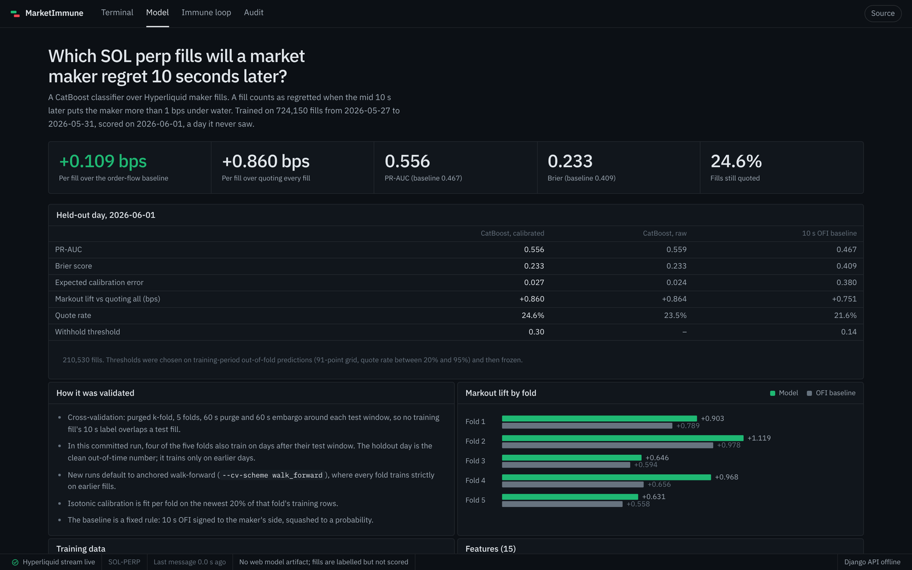

# MarketImmune

**Predicts which SOL perp fills a market maker will regret 10 seconds later.**

Trained on 724,150 Hyperliquid SOL maker fills. On a held-out day the model never
saw, its quoting policy beats a simple order-flow baseline by **+0.109 bps per
fill**. Small, real, and measured the honest way.


## The result

From [`docs/benchmarks/hyperliquid_markout_SOL_20260527_20260531_holdout_20260601.json`](docs/benchmarks/hyperliquid_markout_SOL_20260527_20260531_holdout_20260601.json)
(`holdout_split`): train on May 27 to 31, 2026, score June 1.

| Held-out day, 210,530 fills | CatBoost | 10 s event-OFI baseline |
|---|---:|---:|
| Markout lift vs quoting every fill | **+0.860 bps** | +0.751 bps |
| Lift over the baseline | **+0.109 bps** | |
| PR-AUC | 0.556 | 0.467 |
| Brier score | 0.233 | 0.409 |
| Expected calibration error | 0.027 | 0.380 |
| Fills still quoted | 24.6% | 21.6% |

Two things this number says: toxic flow on SOL is real and partly predictable
from the book, and the edge over a one-feature order-flow rule is thin. A
profitable AMM or market maker knows something this model does not yet.

## What "regret" means

A maker fill at price `p` on side `s` (+1 bought, -1 sold) is judged by the first
mid printed at or after 10 seconds:

```
markout_bps = s * (mid_{t+10s} - p) / p * 10_000
regretted   = markout_bps < -1 bps            # under water after the fee
```

The policy skips a fill when `p(regret) >= 0.30`; skipped fills count as 0 bps.
"Lift" is the mean per-fill markout of that policy minus quoting every fill.

## How it was validated, so it could not cheat

- **Forward holdout.** The headline is June 1, scored by a model trained only on
  May 27 to 31. Thresholds and calibration were frozen before that day was read.
- **Purged, embargoed CV for model selection.** The committed run used purged
  k-fold (5 folds, 60 s purge and 60 s embargo, so no training label overlaps a
  test fill). Four of those five folds also train on later days, which is why the
  holdout, not the CV average, is the number to quote.
- **Walk-forward is now the default.** `--cv-scheme walk_forward` (the new
  default) trains every fold strictly on earlier fills; `--cv-scheme purged_kfold`
  reproduces the committed report exactly. Reports record `cv_scheme`.
- **Point-in-time features.** Every feature joins the latest book and asset
  context at or before the fill; a vectorized as-of check raises `LeakageError`
  on any look-ahead.

## The terminal

`frontend/` is an exchange-style terminal (dark, dense, tabular, modelled on
Hyperliquid and Phoenix) that runs with no backend:

- **Live SOL-PERP market** straight from Hyperliquid's public WebSocket and REST
  API: 1m candles, order book with depth, mark, oracle, funding, open interest.
- **Fills tape with a 10 s regret clock.** Every fill waits out the label horizon
  on screen, then settles into its realized maker markout. The regret matrix shows
  the last 100 outcomes at a glance.
- **Quote guard.** With an exported model, each fill is scored in the browser
  (oblivious-tree evaluator plus isotonic calibration, as-of book features) and
  the live withhold precision and policy lift are tracked against what actually
  happened 10 s later. Without one, fills are labelled but not scored, and the UI
  says so.
- **Model report** built from the committed JSON: holdout table, per-fold lift,
  validation protocol, data, features, and the exact rerun command.



- **Immune loop and audit trail** from the Django API, with a clearly badged
  sample run when the API is not up.

Under the hood: one `requestAnimationFrame` flush per frame no matter how many
WebSocket messages arrive, slice-level subscriptions so the book does not
re-render when the tape moves, CSS-only countdowns, and TypeScript feature and
model code pinned to the Python implementation by parity tests. React Bits
supplies four small components (rolling price digits, count-ups, ID reveal,
status marks); see [`frontend/src/components/reactbits/NOTICE.md`](frontend/src/components/reactbits/NOTICE.md).

## Performance

The pipeline was rewritten around NumPy index arrays (threshold sweeps as one sort
plus prefix sums, `searchsorted` as-of joins, batched scoring), borrowing three
ideas from [DeepSeek's DeepInfer](https://github.com/deepseek-ai/DeepInfer):
overlap I/O with compute, bounded replay of a sliding window, and batch-invariant
inference. Same inputs, same report: every metric matches the original code to
within 2e-13. Details and methodology in [docs/performance.md](docs/performance.md).

| Stage, on a panel shaped like the SOL run | Before | After |
|---|---:|---:|
| Fold-local threshold selection, 724K fills x 91 thresholds | 39.6 s | 0.61 s |
| Deployment threshold sweep | 9.6 s | 0.15 s |
| OFI windows, 400K book snapshots | 5.3 s | 0.91 s |
| As-of feature join, 190K fills | 8.7 s | 2.0 s |
| Score 2,000 fills | 0.35 s one by one | 0.012 s batched |
| Full training run (CatBoost fits unchanged at ~94 s) | 200 s | 99 s |

## Quickstart

```powershell
# Backend (optional for the terminal; needed for the loop, audit, and scoring APIs)
python -m pip install -e ".[dev]"
python manage.py migrate
python manage.py runserver 127.0.0.1:8000

# Frontend
npm.cmd run setup:frontend
npm.cmd run dev:frontend          # http://127.0.0.1:5173/#/terminal
```

Django serves the built SPA at `http://127.0.0.1:8000/dashboard/live/#/terminal`
after `npm.cmd run build:django`.

### Reproduce the benchmark

Needs the local Gold partitions under `data/hyperliquid/gold/hyperliquid/training/SOL/`
(produced by `scripts/backfill_hyperliquid_day.py` from the requester-pays archive):

```powershell
python -m pip install -e ".[dev,hyperliquid,training]"
python -m scripts.train_hyperliquid_markout --coin SOL --dates 20260527..20260531 `
  --holdout-date 20260601 --horizon 10s --iterations 150 --n-splits 5 `
  --cv-scheme purged_kfold `
  --report docs/benchmarks/hyperliquid_markout_SOL_20260527_20260531_holdout_20260601.json `
  --model-out .tmp/benchmarks/hyperliquid_catboost_SOL_10s.cbm
```

Drop `--cv-scheme purged_kfold` to run the walk-forward version.

### Score live fills in the terminal

```powershell
python -m scripts.export_markout_web_model `
  --model .tmp/benchmarks/hyperliquid_catboost_SOL_10s.cbm `
  --report docs/benchmarks/hyperliquid_markout_SOL_20260527_20260531_holdout_20260601.json
```

This writes `frontend/public/model/markout.json`; the terminal picks it up on the
next load. The same file also serves predictions from Django without CatBoost
installed (`MARKETIMMUNE_PROMOTED_MARKOUT_MODEL_PATH=...markout.json`).

### Checks

```powershell
ruff check . ; python scripts/typecheck.py ; python scripts/check_line_limit.py
python -m coverage run -m pytest ; python -m coverage report      # gate: 95%
cd frontend ; npm run typecheck ; npm test ; npm run build
```

## Repository map

```text
marketimmune/   ingest, labels, features, models (splits, evaluation, scorer), agents
scripts/        backfill, training, export, benchmarks, parity fixtures
dashboard/      Django API, persistence, audit trail, built SPA host
frontend/       React + TypeScript terminal
docs/           benchmark artifacts, performance notes, design contract
```

See [ARCHITECTURE.md](ARCHITECTURE.md) for the data flow diagram. The standalone
backtesting engine that grew out of this repo lives at
[Zwc-11/Hindsight](https://github.com/Zwc-11/Hindsight).

## Scope

- Research system. No orders are sent; no keys are held.
- One coin, five training days, one holdout day. Quote it as a SOL panel result,
  not a multi-coin benchmark.
- Live browser features are rebuilt from the WebSocket book, whose update cadence
  can differ from the archive snapshots the model was trained on.
