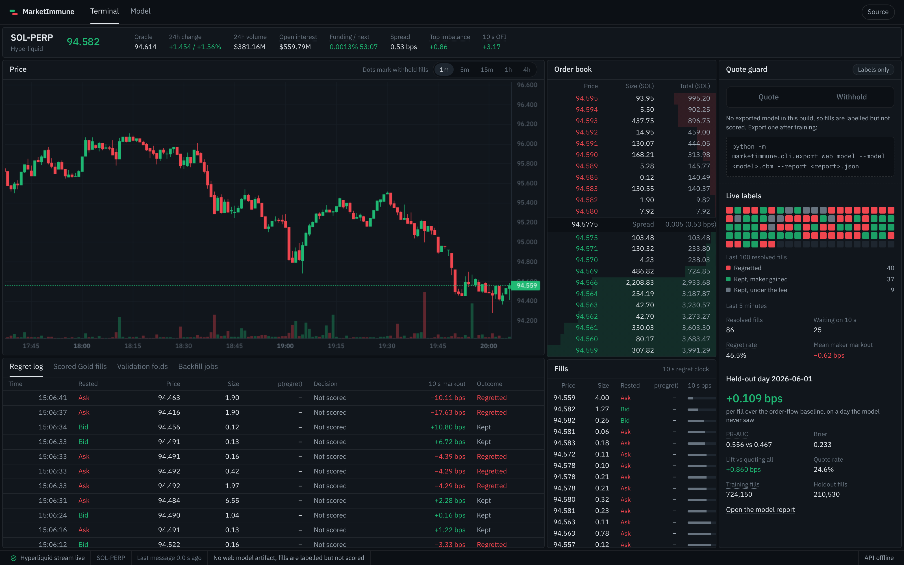
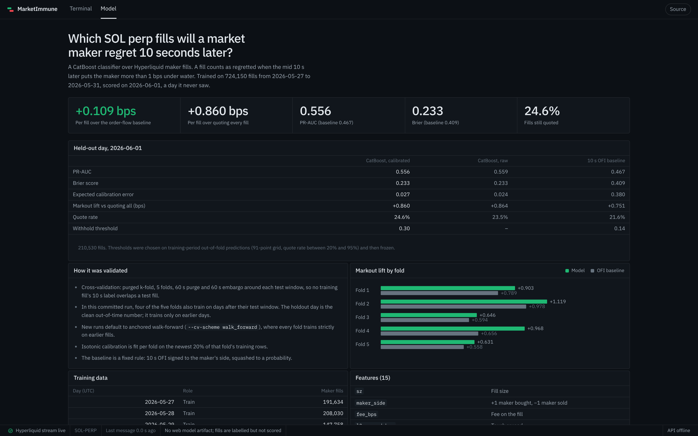

# MarketImmune

**Predicts which perp fills a Hyperliquid market maker will regret 10 seconds later, and
tests, under rules committed before the data is seen, which public signals help.**

BTC, ETH and SOL perps: December 2025 from the Albers et al. L4 archive, April to October
2026 from Hyperliquid's node fills. Every number below is read from a committed report in
`eval/`; the rules are in `docs/preregistration/` and the write-ups in `docs/research/`.



## Results

### 1. What predicts a toxic fill (pre-registered, 60 days, 3 coins)

From [`docs/research/a1-results.md`](docs/research/a1-results.md): every day from Sep 1 to
Oct 31, 2026 except Oct 28, each scored by models trained on the 7 days before it. Each rung
adds one feature group to the rung above. Brier improvement ×1e-3 (positive = better): mean
over days [bootstrap 95%], days improved.

| Feature group added | BTC (17.5M fills) | ETH (9.3M) | SOL (5.0M) |
|---|---|---|---|
| Binance-Hyperliquid price gap | +24.0 [+22.8, +25.1], 60/60 | +24.8 [+23.6, +26.1], 60/60 | +28.1 [+26.6, +29.7], 60/60 |
| Taker's wallet score | +6.8 [+5.7, +7.9], 58/60 | +6.0 [+4.8, +7.3], 58/60 | +6.8 [+6.0, +7.7], 60/60 |
| Taker's priority fees | -0.01 [-0.27, +0.23], 31/60 | +0.17 [-0.11, +0.45], 35/60 | +0.06 [-0.26, +0.39], 33/60 |

- The price gap and the wallet score hold in every coin on both registered metrics (Brier,
  and pinball loss at τ = 0.1), each with a Holm-adjusted p below 1e-4. Together they take
  Brier from 0.212-0.223 to 0.182-0.192.
- The registered claim that priority fees add information is **rejected** in all three
  coins. During CEX moves, where it should be strongest, the fee rung is slightly worse.
  Whatever a priority fee says about a taker, the gap and the wallet score already say.
- At the secondary horizons the picture holds: the gap in 3/3 coins at 1 s and 60 s, the
  wallet score in 3/3 at 1 s and 2/3 at 60 s. Fees leave one trace, at 1 s: Brier better by
  +0.5 ×1e-3 in every coin, about 2% of the gap's gain, which fails the registered rules
  (BTC's placebo p 0.098; pinball improves only in BTC). It is re-tested, on its own, on
  January 2027 (section 5).
- The same ladder on December 2025: the gap was claimed on SOL and replicated on ETH; the
  wallet score, exploratory on SOL, was confirmed on ETH under a second registration. Lost
  cancel races and forecast liquidations, tested the same way, came back null
  ([SOL](docs/research/sol-dec-2025-ladder-results.md),
  [ETH](docs/research/eth-dec-2025-ladder-results.md)).

### 2. Forced-liquidation flow (exploratory, SOL and ETH, December 2025)

From [`docs/research/forecaster-v2.md`](docs/research/forecaster-v2.md): will at least $10k
of liquidations hit a side in the next 60 s? v2 replaces v1's margin-free liquidation-price
prior with exact prices from position snapshots, re-solved as each wallet trades.

- Against v1, 60 s Brier ×1e-3 improves by +0.144 [+0.071, +0.228] on SOL (14/15 days) and
  +0.080 [+0.036, +0.124] on ETH (12/15).
- At the last grid time before a liquidation burst, the alarm is on for 49.6% of SOL bursts
  (v1: 26.8%) and 50.2% of ETH bursts (v1: 36.0%), at a 2.6-2.7% alarm rate.
- It does not beat a persistence forecast on its own: liquidations still arrive in bursts
  the book does not predict.

### 3. Can a maker use it? (block-accurate simulator, December 2025)

From [`docs/research/block-simulator.md`](docs/research/block-simulator.md): the rebuilt L4
book replayed block by block with our quotes in the queue, HyperCore's order inside a block
(post-only, then cancels, then takers), latency, and the 1.5 bp maker fee. Given
hftbacktest's queue rule, it agrees with hftbacktest to 0.1 bps per filled dollar on 31 of
31 days.

| ETH, Dec 10-31, exact queue | Fills | bps per filled $ | Before fee | USD per day |
|---|---:|---:|---:|---:|
| Always quote at the touch | 314,835 | -3.33 | -1.83 | -1,772 |
| Pull on the CEX gap | 275,725 | -3.11 | -1.61 | -1,441 |
| Pull on the model's 10th percentile | 14,515 | -2.21 | -0.71 | -84 |

- At matched fill volume, the model's pull timing beats the same signal shifted in time by
  +0.54 bps per filled dollar on SOL [+0.42, +0.67] and +0.44 on ETH [+0.29, +0.60].
- Nothing is profitable. The best point in either coin is ETH at a 2 bp pull limit: -1.80
  bps all in, -0.30 before the fee. The signal's timing is worth about half a basis point;
  the maker fee is 1.5.
- Stepping back to the second price level instead of pulling loses more: -283 USD a day
  against pulling on SOL and -901 on ETH, better on 1 of 48 days. Fills one level back come
  after the touch is swept or cancelled, and they are the most adversely selected in the
  study (-2.2 to -2.7 bps at 1 s, against -1.7 at the touch).
- No fee tier closes the gap. Re-priced at every tier of Hyperliquid's maker schedule, down to
  the 0.3 bp rebate, no maker's daily PnL interval is above zero. A touch quoter needs a
  1.7-1.85 bp rebate; ETH at the 2 bp limit breaks even only at the top rebate tier, which its
  volume does not reach.

### 4. Live paper trading (one night, 2026-11-06)

From [`docs/research/paper-trading.md`](docs/research/paper-trading.md):

- **Setup.** Every strategy above ran live on Hyperliquid's public feed for nine coins, with a
  Coinbase reference. Paper orders were matched against the real trades on block time, with
  200 ms orders, from a machine that sees Hyperliquid about 340 ms late.
- **Selection.** Four strategies picked in the first hour were registered before the next hours
  existed ([registration](docs/preregistration/paper-forward-test-20261106.md)) and tested on
  3.5 held-out hours.

| Held-out 3.5 h, nine coins | Fills | bps per filled $ | USD per hour [95%] |
|---|---:|---:|---|
| Always quote at the touch | 14,143 | -3.49 | -721 [-809, -561] |
| Pull on the CEX gap, 2 bps (December's stale rule) | 9,703 | -2.56 | -369 [-474, -207] |
| Pull on the live model | 10,563 | -2.88 | -441 [-568, -263] |
| Pull on a 0.25 bp gap, quote inside wide spreads | 1,860 | **+1.67** | +61 [-39, +164] |
| Take on a 10 bp gap | 116 | -3.60 | -12 [-26, -1] |

- **The touch quoter loses live just as the December simulator said** (-3.19 to -3.35 bps there),
  in all 15 quarter-hours.
- **Pulling on very small gaps came out positive** (+$16 to +$61 an hour) and beat the touch
  quoter in 14-15 of 15 quarter-hours. It does not pass the registered rule: every interval
  includes zero.
- **Its gain is position timing, not spread.** It quotes only the side the Coinbase lead leaves
  safe, so its inventory leads Hyperliquid's next move.
- **A 24-hour confirmation is registered** ([registration](docs/preregistration/paper-confirmation-20261106.md)).
  `scripts/run_paper_live.ps1` runs it and serves the web terminal's live Paper trading page at
  `http://127.0.0.1:8765/#/paper`.

### 5. What is next, and what is closed

- **Pre-registered: January 2027**
  ([`docs/preregistration/jan-2027-confirmation.md`](docs/preregistration/jan-2027-confirmation.md)).
  The gap (J1) and the wallet score (J2) at 10 s, and the 1 s fee trace (J3), on a month no
  model has seen, with A1's rules and scorer unchanged. The data is complete in early February
  2027; `scripts/run_jan2027.ps1` runs it end to end and refuses to start unless the
  registration is committed and unchanged.
- **Closed: forced flow as a toxicity signal.** Null as a markout feature in both December
  ladders, no better than persistence as a forecaster, and no gain in the simulator; the fixes
  need position snapshots the archive does not have
  ([forecaster v2, Closed](docs/research/forecaster-v2.md)).
- **Closed: the cancel-first race experiments (Price of Priority E1).** They need the
  `replica_cmds` action log, 151-257 GiB a day on paid AWS, and the extractor was never built;
  the A1 gate that would have justified it failed
  ([plan status](docs/plans/price_of_priority.md)).

### Where it started: one coin, one held-out day

The terminal's live model. From
[`eval/markout_sol_10s/hyperliquid_markout_SOL_20260527_20260531_holdout_20260601.json`](eval/markout_sol_10s/hyperliquid_markout_SOL_20260527_20260531_holdout_20260601.json)
(`holdout_split`): train on May 27 to 31, 2026, score June 1.

| Held-out day, 210,530 fills | CatBoost | 10 s event-OFI baseline |
|---|---:|---:|
| Markout lift vs quoting every fill | **+0.860 bps** | +0.751 bps |
| Lift over the baseline | **+0.109 bps** | |
| PR-AUC | 0.556 | 0.467 |
| Brier score | 0.233 | 0.409 |
| Expected calibration error | 0.027 | 0.380 |
| Fills still quoted | 24.6% | 21.6% |

The policy skips a fill when `p(regret) >= 0.30`; skipped fills count as 0 bps. "Lift" is
the mean per-fill markout of that policy minus quoting every fill. Quote it as a single-day
SOL result; the sections above are the tests that generalise it.

## What "regret" means

A maker fill at price `p` on side `s` (+1 bought, -1 sold) is judged by the mid 10 seconds
later:

```
markout_bps = s * (mid_{t+10s} - p) / p * 10_000
regretted   = markout_bps < -1 bps            # under water after the fee
```

The first benchmark takes the first book mid at or after 10 s. The 2026 runs, which have
fills but no book, measure from the last trade-implied mid before the fill's block; on
December 2025 that markout correlates 0.95 (SOL) and 0.98 (ETH) with the book's at 10 s.
Each pre-registration states its exact label.

## How the results were kept honest

- **Pre-registration.** The A1 rules (rungs, days, tests, claims, placebo) were committed
  as `56ec53e` before any model saw a 2026 date, and `scripts/run_a1.ps1` refuses to train
  if that file is uncommitted or changed. The December ladders were registered the same
  way. Deviations are logged in each file, and nulls are reported next to the claims.
- **Forward-only validation.** Each tested day is scored by a model trained on the 7 days
  before it, minus a 60 s purge.
- **Multiple testing.** Diebold-Mariano on daily losses, Holm across each family, and
  stationary-bootstrap intervals. A claim needs both registered metrics.
- **Placebos.** The fee features computed from the opposite side (A1); the model's signal
  shifted in time (simulator).
- **Point-in-time features.** Every feature joins the latest book and asset context
  strictly before the fill. Each Gold partition carries a no-look-ahead check (features
  recomputed with the future deleted), and a report is `leakage_safe` only if every
  partition passed.

## The terminal

`frontend/` is an exchange-style terminal (dark, dense, tabular, modelled on
Hyperliquid and Phoenix) that runs with no backend:

- **Live SOL-PERP market** straight from Hyperliquid's public WebSocket and REST
  API: 1m candles, order book with depth, mark, oracle, funding, open interest.
- **Fills tape with a 10 s regret clock.** Every fill waits out the label horizon
  on screen, then settles into its realized maker markout. The regret matrix shows
  the last 100 outcomes at a glance.
- **Quote guard.** With an exported model, each fill is scored in the browser
  (oblivious-tree evaluator plus isotonic calibration, as-of book features) and
  the live withhold precision and policy lift are tracked against what actually
  happened 10 s later. Without one, fills are labelled but not scored, and the UI
  says so.
- **Model report** built from the committed JSON: holdout table, per-fold lift,
  validation protocol, data, features, and the exact rerun command.



Under the hood: one `requestAnimationFrame` flush per frame no matter how many
WebSocket messages arrive, slice-level subscriptions so the book does not
re-render when the tape moves, CSS-only countdowns, and TypeScript feature and
model code pinned to the Python implementation by parity tests. React Bits
supplies three small components (rolling price digits, count-ups, status marks); see [`frontend/src/components/reactbits/NOTICE.md`](frontend/src/components/reactbits/NOTICE.md).

## Performance

The pipeline was rewritten around NumPy index arrays (threshold sweeps as one sort
plus prefix sums, `searchsorted` as-of joins, batched scoring), borrowing three
ideas from [DeepSeek's DeepInfer](https://github.com/deepseek-ai/DeepInfer):
overlap I/O with compute, bounded replay of a sliding window, and batch-invariant
inference. Same inputs, same report: every metric matches the original code to
within 2e-13. Details and methodology in [docs/performance.md](docs/performance.md).

| Stage, on a panel shaped like the SOL run | Before | After |
|---|---:|---:|
| Fold-local threshold selection, 724K fills x 91 thresholds | 39.6 s | 0.61 s |
| Deployment threshold sweep | 9.6 s | 0.15 s |
| OFI windows, 400K book snapshots | 5.3 s | 0.91 s |
| As-of feature join, 190K fills | 8.7 s | 2.0 s |
| Score 2,000 fills | 0.35 s one by one | 0.012 s batched |
| Full training run (CatBoost fits unchanged at ~94 s) | 200 s | 99 s |
| Albers SOL day to Silver book (real data, 24 h) | 134 s | 58 to 74 s |
| No-look-ahead check, 200 fills on a real day | 103 s | 1.5 s |

## Quickstart

```powershell
python -m pip install -e ".[training,server,aws,dev]"    # or: uv sync --extra training --extra server --extra dev

# Terminal only (no backend needed): http://127.0.0.1:5173/#/terminal
npm --prefix frontend install
npm --prefix frontend run dev

# Django API + the built terminal on http://127.0.0.1:8000/
npm --prefix frontend run build:server
python server/manage.py migrate
python server/manage.py runserver
```

Every pipeline command is `python -m marketimmune.cli.<command> --help`; the
`Makefile` (or `.\make.ps1` on Windows) wraps the common ones.

| Command | What it does |
|---|---|
| `download_albers` | Albers et al. Dec 2025 L4 archives into `data/bronze/albers` (166 GB, resumable) |
| `download_binance` | Binance aggTrades for the CEX-gap feature |
| `build_albers_silver` / `build_albers_fills` / `build_albers_gold` | Albers archives to Silver book + fills, then Gold labels and training rows |
| `run_albers_month` | Every Albers stage for a date range: Silver, fills, positions, forced-flow forecast, Gold, enrich |
| `build_positions` / `forced_forecast` | Wallet positions from fills; forced-liquidation flow forecast and its evaluation |
| `enrich_albers` | Ladder columns L2 and L3 (wallet scores, lost races, realised and forecast forced flow) |
| `backfill_day` | One day from the requester-pays Hyperliquid S3 archive to Gold |
| `rebuild_training_rows` | Recompute Gold training rows and their leakage sidecars |
| `train` / `train_quantile` | CatBoost classifier (report, calibrator) / LightGBM quantile ladder, out of fold |
| `compare_rungs` / `mcs_rungs` | Diebold-Mariano by day and the Model Confidence Set over rungs |
| `simulate_policy` / `decompose` | Maker PnL under quoting policies; adverse selection by regime and feature group |
| `export_web_model` | Compact model JSON for the browser and CatBoost-free serving |
| `probe_s3_day`, `find_first_priority_day`, `snapshot_asset_meta` | Price of Priority data probes |
| `pull_node_fills` / `build_node_gold` | 2026 fills from `node_fills_by_block`; Gold rows from fills alone, in execution order |
| `priority_fee_bands` / `validate_trade_mids` | Priority-fee rollout and markout by fee band; trade-implied mid against the book |
| `a1_ladder` / `score_a1` / `a1_report` / `a1_lead_time` | The A1 ladder: one rung per run, verdicts, report tables, lead-time curve |
| `score_ladder` | Verdicts of the December 2025 ladders |
| `pull_snapshots` / `forced_v2` / `forced_v2_checks` | Hydromancer position snapshots; forecaster v2 and its checks |
| `quote_signals` / `simulate_quotes` | Quote-time model quantiles; the block simulator |
| `hft_baseline` / `pull_frontier` | hftbacktest reconciliation; pull-limit frontier with a time-shifted placebo (`--back-off`: step back instead of pulling) |
| `fee_tiers` | Every simulated maker's PnL at each Hyperliquid maker fee tier, and its break-even fee |
| `paper_trade` / `paper_report` | Live paper trading on Hyperliquid (or a replay of a recorded night), with the web terminal's Paper trading page (`--serve 8765 --web frontend/dist`); its PnL by component |
| `paper_journal` | Reads a paper run's decision journal (every side change, fill with the signals behind it, per-minute counters): where each strategy's fills made or lost money, by horizon and by what it saw |

### Reproduce the results

Each write-up in `docs/research/` opens with the commands that produce its numbers. A1,
after `pull_node_fills` has the fills on disk:

```powershell
powershell -ExecutionPolicy Bypass -File .\scripts\run_a1.ps1 -Coins SOL     # then ETH, BTC
powershell -ExecutionPolicy Bypass -File .\scripts\run_a1_secondary.ps1
python -m marketimmune.cli.a1_report --dir eval/a1 --out eval/a1/a1_tables.md
```

January 2027, once the month is in the archives (commands in the registration):

```powershell
powershell -ExecutionPolicy Bypass -File .\scripts\run_jan2027.ps1
```

### Reproduce the single-day benchmark

Needs the local Gold partitions under `data/gold/hyperliquid/training/SOL/`
(produced by `python -m marketimmune.cli.backfill_day` from the requester-pays archive)
and the trainer as of commit `7035c0c`, the last one with purged k-fold:

```powershell
git checkout 7035c0c
python -m pip install -e ".[training,aws,dev]"
python -m marketimmune.cli.train --coin SOL --dates 20260527..20260531 `
  --holdout-date 20260601 --horizon 10s --iterations 150 --n-splits 5 `
  --cv-scheme purged_kfold `
  --report eval/markout_sol_10s/hyperliquid_markout_SOL_20260527_20260531_holdout_20260601.json `
  --model-out data/models/hyperliquid_catboost_SOL_10s.cbm
```

### Score live fills in the terminal

```powershell
python -m marketimmune.cli.export_web_model `
  --model data/models/hyperliquid_catboost_SOL_10s.cbm `
  --report eval/markout_sol_10s/hyperliquid_markout_SOL_20260527_20260531_holdout_20260601.json
```

This writes `frontend/public/model/markout.json`; the terminal picks it up on the
next load. The same file also serves predictions from Django without CatBoost
installed (`MARKETIMMUNE_PROMOTED_MARKOUT_MODEL_PATH=...markout.json`).

### Checks

```powershell
.\make.ps1 ci      # ruff, line limit, mypy --strict, pytest + coverage (gate 90%), cargo test, frontend tests
```

## Repository layout

Laid out like [DeepInfer](https://github.com/deepseek-ai/DeepInfer): one Python
package split by pipeline stage, native code in its own top-level folder, and
benchmarks in `eval/` next to the results they produced.

```text
MarketImmune/
├── marketimmune/              Python package, one sub-package per pipeline stage
│   ├── sources/               Bronze: fetch and parse external data
│   │   ├── hyperliquid_l2_archive.py   S3 l2Book archive
│   │   ├── hyperliquid_asset_ctxs.py   funding / open interest / basis
│   │   ├── hyperliquid_node_fills.py   node_fills_by_block; pair maker and taker legs
│   │   ├── hyperliquid_s3.py           requester-pays S3 listing and downloads
│   │   ├── hyperliquid_replica.py      replica_cmds parser (actions, statuses)
│   │   ├── hyperliquid_meta.py         asset tick and lot decimals
│   │   ├── albers_download.py          Albers et al. L4 dataset from Zenodo
│   │   ├── albers_l4.py                Albers order statuses + book diffs -> timed book
│   │   └── binance_aggtrades.py        Binance aggTrades (CEX reference price)
│   ├── lake/                  Silver/Gold parquet: tables.py (layout + writers), gold.py
│   │                          (markout labels), backfill.py (daily S3 -> Gold), checks.py
│   ├── labels/                markout.py (the regret label), leakage.py (point-in-time checks)
│   ├── features/              training_rows.py (as-of join, OFI windows), cex_gap.py, order_events.py,
│   │                          wallet_toxicity.py, forced_flow_features.py (ladder rungs L1 to L3),
│   │                          trade_state.py (2026 rows from fills alone)
│   ├── forced/                positions.py, forecaster.py, evaluate.py, margin_tiers.py (forced flow),
│   │                          node_book.py (v2: snapshot prices, rolled accounts)
│   ├── models/                cross_validation.py, evaluation.py, quantile_ladder.py, compare.py (DM),
│   │                          mcs.py, decomposition.py
│   ├── sim/                   engine.py (block simulator), strategies.py, signals.py, attribution.py,
│   │                          hft_baseline.py, pnl.py (the older fill filter)
│   ├── paper/                 live paper trading: events.py (feeds), signals.py (gap, wallets, model),
│   │                          orders.py (queue fills), strategies.py, engine.py, live.py (run, replay)
│   ├── serving/               scorer.py (CatBoost), oblivious_trees.py (no CatBoost), gold_scoring.py
│   ├── priority/              fills.py (execution order), fees.py (priority fees in bps), nonces.py
│   ├── cli/                   python -m marketimmune.cli.<command>
│   ├── config.py              data paths and configs/*.yaml
│   ├── utils.py               date and list parsing shared by every stage
│   └── logger.py              init_logger(__name__)
├── crates/                    Rust (cargo workspace)
│   ├── hl-replay/             order book under HyperCore's cancel-first batch order
│   └── hl-replay-py/          PyO3 bindings, Python module hl_replay
├── server/                    Django: settings.py, manage.py
│   └── api/                   models, views, services, migrations, static/terminal (built UI)
├── frontend/                  React + TypeScript + Vite terminal
├── eval/                      benchmark harnesses and committed results
│   ├── a1/                    A1 reports, verdicts and tables (results section 1)
│   ├── markout_sol_10s/       the single-day SOL report
│   └── pipeline_speed/        bench.py + results.json
├── tests/                     mirrors marketimmune/, plus server/ and deploy/
├── configs/                   data windows, episodes, simulator (YAML)
├── deploy/                    always-on recorder (VPS) and EC2 notes
├── docs/                      preregistration/ (rules), research/ (write-ups), performance, plans, images
├── scripts/                   run_a1.ps1, run_a1_secondary.ps1, run_eth_sim.ps1; typecheck.py, check_line_limit.py
└── data/                      gitignored: bronze/ silver/ gold/ models/ logs/
```

See [ARCHITECTURE.md](ARCHITECTURE.md) for the data flow. The standalone
backtesting engine that grew out of this repo lives at
[Zwc-11/Hindsight](https://github.com/Zwc-11/Hindsight).

## Scope

- Research system. No orders are sent; no keys are held.
- Hyperliquid BTC, ETH and SOL perps only. December 2025 rests on the Albers et al. L4
  rebuild; 2026 on node fills, which carry trades but no book.
- The simulator's fills are counterfactual: our quotes enter the real queue, but other
  traders do not react to them.
- The terminal's live model is the single-day SOL benchmark. Its browser features are
  rebuilt from the WebSocket book, whose update cadence can differ from the archive
  snapshots the model was trained on.
