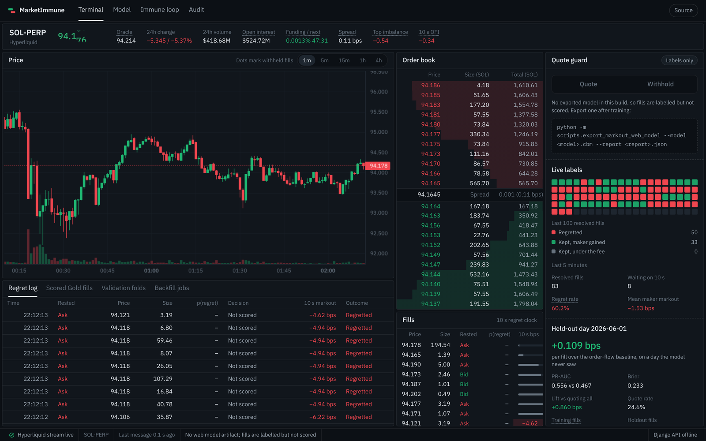

# MarketImmune

**Predicts which SOL perp fills a market maker will regret 10 seconds later.**

Trained on 724,150 Hyperliquid SOL maker fills. On a held-out day the model never
saw, its quoting policy beats a simple order-flow baseline by **+0.109 bps per
fill**. Small, real, and measured the honest way.



## The result

From [`eval/markout_sol_10s/hyperliquid_markout_SOL_20260527_20260531_holdout_20260601.json`](eval/markout_sol_10s/hyperliquid_markout_SOL_20260527_20260531_holdout_20260601.json)
(`holdout_split`): train on May 27 to 31, 2026, score June 1.

| Held-out day, 210,530 fills | CatBoost | 10 s event-OFI baseline |
|---|---:|---:|
| Markout lift vs quoting every fill | **+0.860 bps** | +0.751 bps |
| Lift over the baseline | **+0.109 bps** | |
| PR-AUC | 0.556 | 0.467 |
| Brier score | 0.233 | 0.409 |
| Expected calibration error | 0.027 | 0.380 |
| Fills still quoted | 24.6% | 21.6% |

Two things this number says: toxic flow on SOL is real and partly predictable
from the book, and the edge over a one-feature order-flow rule is thin. A
profitable AMM or market maker knows something this model does not yet.

## What "regret" means

A maker fill at price `p` on side `s` (+1 bought, -1 sold) is judged by the first
mid printed at or after 10 seconds:

```
markout_bps = s * (mid_{t+10s} - p) / p * 10_000
regretted   = markout_bps < -1 bps            # under water after the fee
```

The policy skips a fill when `p(regret) >= 0.30`; skipped fills count as 0 bps.
"Lift" is the mean per-fill markout of that policy minus quoting every fill.

## How it was validated, so it could not cheat

- **Forward holdout.** The headline is June 1, scored by a model trained only on
  May 27 to 31. Thresholds and calibration were frozen before that day was read.
- **Purged, embargoed CV for model selection.** The committed run used purged
  k-fold (5 folds, 60 s purge and 60 s embargo, so no training label overlaps a
  test fill). Four of those five folds also train on later days, which is why the
  holdout, not the CV average, is the number to quote.
- **Forward-only CV by default.** `--cv-scheme rolling_daily` (the default) and
  `walk_forward` train every fold strictly on earlier fills; `--cv-scheme
  purged_kfold` reproduces the committed report exactly. Reports record `cv_scheme`.
- **Point-in-time features.** Every feature joins the latest book and asset
  context at or before the fill; a vectorized as-of check raises `LeakageError`
  on any look-ahead.

## The terminal

`frontend/` is an exchange-style terminal (dark, dense, tabular, modelled on
Hyperliquid and Phoenix) that runs with no backend:

- **Live SOL-PERP market** straight from Hyperliquid's public WebSocket and REST
  API: 1m candles, order book with depth, mark, oracle, funding, open interest.
- **Fills tape with a 10 s regret clock.** Every fill waits out the label horizon
  on screen, then settles into its realized maker markout. The regret matrix shows
  the last 100 outcomes at a glance.
- **Quote guard.** With an exported model, each fill is scored in the browser
  (oblivious-tree evaluator plus isotonic calibration, as-of book features) and
  the live withhold precision and policy lift are tracked against what actually
  happened 10 s later. Without one, fills are labelled but not scored, and the UI
  says so.
- **Model report** built from the committed JSON: holdout table, per-fold lift,
  validation protocol, data, features, and the exact rerun command.


Under the hood: one `requestAnimationFrame` flush per frame no matter how many
WebSocket messages arrive, slice-level subscriptions so the book does not
re-render when the tape moves, CSS-only countdowns, and TypeScript feature and
model code pinned to the Python implementation by parity tests. React Bits
supplies three small components (rolling price digits, count-ups, status marks); see [`frontend/src/components/reactbits/NOTICE.md`](frontend/src/components/reactbits/NOTICE.md).

## Performance

The pipeline was rewritten around NumPy index arrays (threshold sweeps as one sort
plus prefix sums, `searchsorted` as-of joins, batched scoring), borrowing three
ideas from [DeepSeek's DeepInfer](https://github.com/deepseek-ai/DeepInfer):
overlap I/O with compute, bounded replay of a sliding window, and batch-invariant
inference. Same inputs, same report: every metric matches the original code to
within 2e-13. Details and methodology in [docs/performance.md](docs/performance.md).

| Stage, on a panel shaped like the SOL run | Before | After |
|---|---:|---:|
| Fold-local threshold selection, 724K fills x 91 thresholds | 39.6 s | 0.61 s |
| Deployment threshold sweep | 9.6 s | 0.15 s |
| OFI windows, 400K book snapshots | 5.3 s | 0.91 s |
| As-of feature join, 190K fills | 8.7 s | 2.0 s |
| Score 2,000 fills | 0.35 s one by one | 0.012 s batched |
| Full training run (CatBoost fits unchanged at ~94 s) | 200 s | 99 s |

## Quickstart

```powershell
python -m pip install -e ".[training,server,aws,dev]"    # or: uv sync --extra training --extra server --extra dev

# Terminal only (no backend needed): http://127.0.0.1:5173/#/terminal
npm --prefix frontend install
npm --prefix frontend run dev

# Django API + the built terminal on http://127.0.0.1:8000/
npm --prefix frontend run build:server
python server/manage.py migrate
python server/manage.py runserver
```

Every pipeline command is `python -m marketimmune.cli.<command> --help`; the
`Makefile` (or `.\make.ps1` on Windows) wraps the common ones.

| Command | What it does |
|---|---|
| `download_albers` | Albers et al. Dec 2025 L4 archives into `data/bronze/albers` (166 GB, resumable) |
| `download_binance` | Binance aggTrades for the CEX-gap feature |
| `build_albers_silver` / `build_albers_fills` / `build_albers_gold` | Albers archives to Silver book + fills, then Gold labels and training rows |
| `run_albers_month` | The three Albers stages for a date range |
| `backfill_day` | One day from the requester-pays Hyperliquid S3 archive to Gold |
| `rebuild_training_rows` | Recompute Gold training rows and their leakage sidecars |
| `train` | CatBoost markout model, CV report, calibrator |
| `export_web_model` | Compact model JSON for the browser and CatBoost-free serving |
| `probe_s3_day`, `find_first_priority_day`, `snapshot_asset_meta` | Price of Priority data probes |

### Reproduce the benchmark

Needs the local Gold partitions under `data/gold/hyperliquid/training/SOL/`
(produced by `python -m marketimmune.cli.backfill_day` from the requester-pays archive):

```powershell
python -m pip install -e ".[training,aws,dev]"
python -m marketimmune.cli.train --coin SOL --dates 20260527..20260531 `
  --holdout-date 20260601 --horizon 10s --iterations 150 --n-splits 5 `
  --cv-scheme purged_kfold `
  --report eval/markout_sol_10s/hyperliquid_markout_SOL_20260527_20260531_holdout_20260601.json `
  --model-out data/models/hyperliquid_catboost_SOL_10s.cbm
```

Drop `--cv-scheme purged_kfold` to run the walk-forward version.

### Score live fills in the terminal

```powershell
python -m marketimmune.cli.export_web_model `
  --model data/models/hyperliquid_catboost_SOL_10s.cbm `
  --report eval/markout_sol_10s/hyperliquid_markout_SOL_20260527_20260531_holdout_20260601.json
```

This writes `frontend/public/model/markout.json`; the terminal picks it up on the
next load. The same file also serves predictions from Django without CatBoost
installed (`MARKETIMMUNE_PROMOTED_MARKOUT_MODEL_PATH=...markout.json`).

### Checks

```powershell
.\make.ps1 ci      # ruff, line limit, mypy --strict, pytest + coverage (gate 90%), cargo test, frontend tests
```

## Repository layout

Laid out like [DeepInfer](https://github.com/deepseek-ai/DeepInfer): one Python
package split by pipeline stage, native code in its own top-level folder, and
benchmarks in `eval/` next to the results they produced.

```text
MarketImmune/
├── marketimmune/              Python package, one sub-package per pipeline stage
│   ├── sources/               Bronze: fetch and parse external data
│   │   ├── hyperliquid_info_api.py     public Info API (candles, meta, asset contexts)
│   │   ├── hyperliquid_l2_archive.py   S3 l2Book archive
│   │   ├── hyperliquid_asset_ctxs.py   funding / open interest / basis
│   │   ├── hyperliquid_node_fills.py   node_fills_by_block; pair maker and taker legs
│   │   ├── hyperliquid_s3.py           requester-pays S3 listing and downloads
│   │   ├── hyperliquid_replica.py      replica_cmds parser (actions, statuses)
│   │   ├── hyperliquid_meta.py         asset tick and lot decimals
│   │   ├── albers_download.py          Albers et al. L4 dataset from Zenodo
│   │   ├── albers_l4.py                Albers order statuses + book diffs -> timed book
│   │   └── binance_aggtrades.py        Binance aggTrades (CEX reference price)
│   ├── lake/                  Silver/Gold parquet: tables.py (layout + writers), gold.py
│   │                          (markout labels), backfill.py (daily S3 -> Gold), checks.py
│   ├── labels/                markout.py (the regret label), leakage.py (point-in-time checks)
│   ├── features/              training_rows.py (as-of join, OFI windows), cex_gap.py
│   ├── models/                cross_validation.py, evaluation.py, calibration.py, promotion.py
│   ├── serving/               scorer.py (CatBoost), oblivious_trees.py (no CatBoost), gold_scoring.py
│   ├── priority/              Price of Priority study: fills.py (priority fees), nonces.py (arrival)
│   ├── cli/                   python -m marketimmune.cli.<command>
│   ├── config.py              data paths and configs/*.yaml
│   └── resilience.py          retries and timeouts for network calls
├── crates/                    Rust (cargo workspace)
│   ├── hl-replay/             order book under HyperCore's cancel-first batch order
│   └── hl-replay-py/          PyO3 bindings, Python module hl_replay
├── server/                    Django: settings.py, urls.py, manage.py
│   └── api/                   models, views, services, migrations, static/terminal (built UI)
├── frontend/                  React + TypeScript + Vite terminal
├── eval/                      benchmark harnesses and committed results
│   ├── markout_sol_10s/       the SOL report quoted above
│   └── pipeline_speed/        bench.py + results.json
├── tests/                     mirrors marketimmune/, plus server/ and deploy/
├── configs/                   data windows, episodes, simulator (YAML)
├── deploy/                    always-on recorder (VPS) and EC2 notes
├── docs/                      performance, plans (v3, Price of Priority), research notes, images
├── scripts/                   developer tooling: typecheck.py, check_line_limit.py
└── data/                      gitignored: bronze/ silver/ gold/ models/ logs/
```

See [ARCHITECTURE.md](ARCHITECTURE.md) for the data flow. The standalone
backtesting engine that grew out of this repo lives at
[Zwc-11/Hindsight](https://github.com/Zwc-11/Hindsight).

## Scope

- Research system. No orders are sent; no keys are held.
- One coin, five training days, one holdout day. Quote it as a SOL panel result,
  not a multi-coin benchmark.
- Live browser features are rebuilt from the WebSocket book, whose update cadence
  can differ from the archive snapshots the model was trained on.
